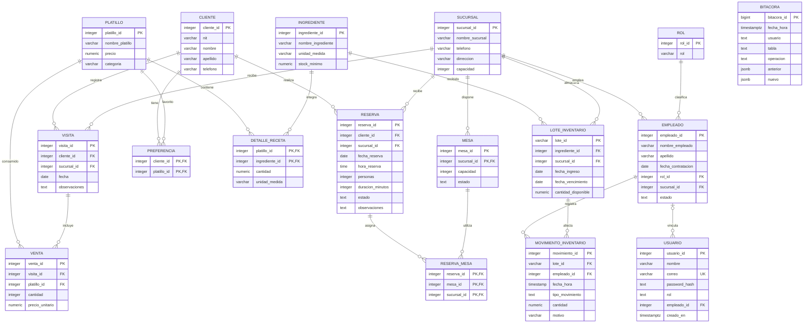

# Modelo de datos

Se conserva el esquema del respaldo `Base_datos_Aurea_Inicio.sql`. Aunque tiene extensión SQL, el archivo es un respaldo **custom de PostgreSQL**. `db/001_base.sql` contiene su estructura exportada con `pg_restore --schema-only --no-owner --no-privileges`.

| Tabla añadida | Uso y relaciones |
| --- | --- |
| usuario | Correo único, hash, rol de acceso; referencia opcional a empleado |
| preferencia | N:M cliente/platillo, con clave primaria compuesta |
| visita | N:1 a cliente y sucursal; fecha y observaciones |
| venta | N:1 a visita y platillo; cantidad positiva y precio histórico |
| bitacora | Usuario, fecha, operación, tabla y versiones JSONB |

La migración agrega duración y observaciones a reservas. Cambia el teléfono de cliente de smallint a varchar(15), y permite decimales en cantidades de inventario y movimientos.

Las cuentas de usuario se crean y se administran desde la sección Usuarios, exclusiva del administrador. La API no permite registro público ni devuelve hashes de contraseña al listar cuentas. Los permisos se obtienen de la base de datos en cada solicitud autenticada.

Las claves compuestas originales conservan la pertenencia de mesa y reserva a sucursal. Las claves foráneas impiden borrar datos utilizados; las reservas se cancelan para conservar su historial.

Las vistas `v_ventas` y `v_alertas_inventario` centralizan cálculos. Los índices cubren fecha/sucursal y cliente de reservas, sucursal/vencimiento de lotes, cliente/fecha de visitas y fecha de bitácora. Los triggers registran cambios dentro de su misma transacción.

Las reservas toman un bloqueo transaccional de sucursal para comprobar cruces de horarios. Esta regla se aplica en la API: cualquier integración que escriba directamente debe usar la misma lógica. En un servidor central se recomienda un proxy HTTPS y acceso privado de PostgreSQL limitado al servidor.

## Diagrama entidad-relación actualizado

GitHub y los visores compatibles con Mermaid muestran este diagrama directamente. Las mesas usan clave compuesta mesa_id/sucursal_id; reserva_mesa también referencia reserva_id/sucursal_id como pareja.

Bitácora recibe eventos de las tablas auditadas por triggers. Su usuario se conserva como texto histórico para no perder la atribución al eliminar cuentas.
